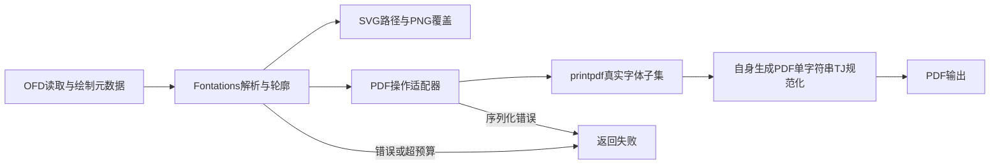

# 无豁免依赖治理验收

日期：2026-10-14。状态：ARCHIVED；本地门禁、最终审查及同源码三平台 CI 全部通过。基线 dev@44e6d8a。
规格：[依赖治理](superpowers/specs/2026-10-14-dependency-remediation.md)，计划：[实施任务](superpowers/plans/2026-10-14-dependency-remediation.md)。

## 实现与兼容性

| 原风险 | 实际替代 |
|---|---|
| RUSTSEC-2026-0187 / lopdf0.31 | printpdf0.12.8 使用 lopdf0.44；外部PDF读取保留lopdf0.45 |
| RUSTSEC-2026-0192 / ttf-parser | skrifa0.44 / Fontations 真实解析、度量、轮廓；tiny-skia替代fontdue栅格化 |
| RUSTSEC-2024-0370 / proc-macro-error | 新PDF依赖链使用proc-macro2-diagnostics；未引入同样停止维护的proc-macro-error2 |

根/Fuzz锁文件均拒绝上述旧包及fontdue。两份审计配置ignore均为空，cargo deny开启all-features且拒绝yanked。CI从仓库外目录运行cargo audit --deny warnings，避免项目配置过滤；另检查无锁文件消费者解析结果。

公共入口保持。PDF真实子集保留复合字形子节点，多个子路径保留洞及开放描边，RGBA保留SMask；同glyph对应多个Unicode使用字体变体，q/Q恢复后同步编码字体。单字符串无位移TJ→Tj语义相同，多项或带位移TJ不变；不剥离源空格。

TTF、双face TTC、命名/CID CFF OTF均有真实解析与输出测试；保留legacy文字基线及推进量，空白字形仍推进，分配前限制字形尺寸/像素。抗锯齿可能不同，不承诺图像字节相同。原PDF→OFD的ToUnicode支持限制保持；未扩展复杂塑形、CA/吊销/印章授权或部署/SLA范围。

## 本地证据

- workspace运行测试2909通过、1忽略；doctest12通过、16忽略，合计2921通过、17忽略。覆盖率49848/53321行，93.4866%，强制门槛90%通过。
- clippy --workspace --all-targets -- -D warnings、cargo fmt --all -- --check、git diff --check均通过。
- 根与Fuzz无配置audit均0漏洞/0warning；cargo deny四项检查通过（多版本提示仍允许，非安全豁免）。无锁消费者236包声明MSRV≤1.88且无问题包；声明检查不替代目标工具链编译。
- 四Fuzz目标fuzz_xml/fuzz_ofd_reader/fuzz_ses_der/fuzz_pdf各100000次通过，无崩溃。它们不覆盖全部字体轮廓输入。
- macOS debug四线程28输入/76有效输出，3317ms，最大RSS897368064字节，约856MiB；不是Linux硬限制或业务SLA证明。
- PDF和字体任务独立审查完成；4项Important（包括一次修复后新发现的q/Q问题）均有真实红→绿和限定重审。最终整体审查无新增Critical/Important；当前SHA CI全部通过。
- 延期Minor：补充字体头可解析但glyph轮廓损坏的直接回归。已有轮廓错误传播、坏/截断字体与预算测试；未发现对应代码缺陷。

## 工程裁决与代价

- 用户授权当前dev直接实施；执行者顺序修改，控制器管理依赖/安全配置。代价：期间dev存在修改，实施阶段依次执行。
- 仅清理本仓库无活动句柄的target/debug/incremental和本轮已结束的target/llvm-cov-target可重建缓存，保留源码、依赖、二进制和证据。代价：重建增量缓存。
- 开启text_layout获得真实字体子集。代价：依赖图和编译体积增加，仍需无豁免审计与MSRV门禁。
- 字体变体及自身PDF规范化保留Unicode提取。代价：额外CPU/内存，原2GiB/30s门禁保持。
- 保留旧legacy基线公式；采用tiny-skia真实覆盖。代价：抗锯齿像素可能不同。
- 最小更新根锁文件；无锁消费者单独检查。代价：两者允许版本可能不同，均检查问题包，目标编译由CI证明。

## 最终CI与提交

实际验证代码提交：`8dd0bbf0b4160c35dab71523d54a18529ec059c4`。

| 门禁 | 最终结果与证据 |
|---|---|
| 三平台 stable / Rust1.88 六矩阵，fmt/bench共8任务 | [CI](https://github.com/easy-4-rust/easyofd-rust/actions/runs/38530452971) success（attempt2） |
| 强制行覆盖率≥90%及报告上传 | [Coverage](https://github.com/easy-4-rust/easyofd-rust/actions/runs/38530453044) success；本地93.4866% |
| 根/Fuzz未过滤审计、deny、无锁消费者 | [Security](https://github.com/easy-4-rust/easyofd-rust/actions/runs/38530453011) success，0漏洞/0warning/0豁免 |
| 四Fuzz目标各100000次 | [Fuzz](https://github.com/easy-4-rust/easyofd-rust/actions/runs/38530470883) success，逐目标日志确认次数 |
| Linux 2GiB / 30s硬约束烟测 | CI Ubuntu stable通过；4线程28输入、76有效输出、1137ms |

首次Windows stable构建发生runner磁盘设备故障：MSVC link.exe无法启动、os error433、STATUS_IN_PAGE_ERROR及checkout文件读取失败。未修改源码，等待其他任务完成后仅重跑该失败任务；第二次构建、测试、Clippy、doctest、示例及收尾全部成功。其他成功任务保持原结果。

最终归档提交仅修改docs，使用skip ci。非文档tree与上述已验证SHA一致；不声称归档提交单独重跑CI。工作区日志与覆盖率JSON保存在本地`target/dependency-remediation-evidence.tar.gz`（可重建日志包不推送Git）。

不执行部署或发布；原服务端库集成契约、业务样本/SLA和正式认证边界保持。

独立最终整体审查无新增Critical/Important；上述延期Minor是测试增强建议，不是已知功能或安全缺陷。
