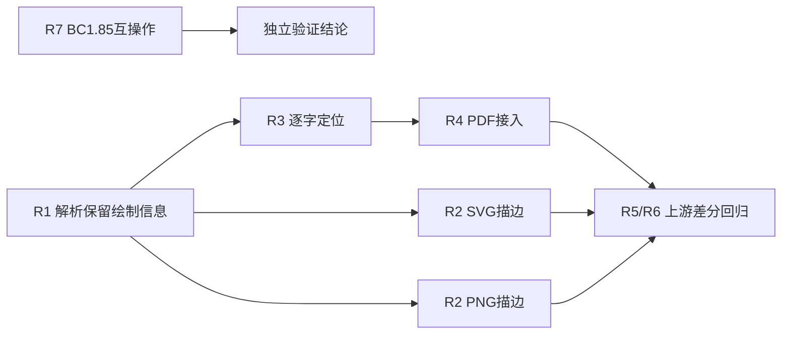

# OFDRW 2.4.0 后续修复对齐要求

日期：2026-10-14。状态：ARCHIVED；实现、本地验证、Rust1.88/stable三平台CI已完成。

## 基线与范围

- Java 更新前：`7459e35082170061efa6b399a6518dbc219f08ac`，项目版本 2.4.0。
- Java 更新后：`84e9eb260ba6fd351ecccf08a01a40305d4af635`，项目版本仍为 2.4.0，BC 1.85。
- Rust 审查提交：`12a0381bfa92a3736b84cadda95f4044c94f22e6`，workspace 0.1.4。
- [上游净差异](https://github.com/ofdrw/ofdrw/compare/7459e35082170061efa6b399a6518dbc219f08ac...84e9eb260ba6fd351ecccf08a01a40305d4af635)：#411 描边、#412 文字步距、#414 BC 升级；5 文件 +292/-5。
- 用户已追加授权完成计划，选择当前dev目录实施。随后已明确授权提交/推送dev；安装、分支切换及发布未授权。

本文件为本次增量需求事实源；沿用仓库已有 Superpowers specs/plans，不引入另一套规格体系。旧版 v1.0.0 规划的完成率和验证记录不能证明本次要求通过。

## 源码核对结论

`CT_Text` 已包含 stroke/fill/颜色/CGTransform，`TextCode` 已包含坐标和步距，`ctm_transform_vector` 已排除平移；需要补齐的是转换生产路径。

`easyofd-reader/src/parser.rs::build_text_object_from_node` 降为简化 TextObject，丢失这些绘制信息；PDF 使用整体 use_text，SVG 只输出填充 text，RasterRenderer 只填充文字。原始 XML/ZIP 保留与 roundtrip 是另一条路径，不应据此断言无损回写失败。

## 可观察要求

| ID | 要求 | 必须提供的证据 |
|---|---|---|
| R1 | 解析保留 Stroke/Fill、显式/继承描边色、线宽、CTM、分段 TextCode 和 CGTransform；默认 Stroke=false、Fill=true | 真实 XML→reader→转换元数据断言；旧 pages()/TextObject 行为兼容 |
| R2 | SVG/PNG 中显式 Stroke=false、省略 Stroke 均不描边；Stroke=true 支持显式及继承颜色 | 四种组合×两种输出；同时验证填充保留，不能只有阴性用例 |
| R3 | 原点应用完整 CTM，字距仅应用线性部分；非零平移不逐字累积 | AB：CTM=[2,0,0,3,100,200]，Boundary=(10,20)，TextCode=(1,2)，Delta=(4,5)，页面点为 (112,226)、(120,241) mm |
| R4 | PDF 竖排文字不重叠，保留 CGTransform、文字变换和分段坐标语义 | “下载次数：1”：CTM=[0,1,-1,0,0.5,-2]，Boundary=(207.5,30)，起点=(1.5,0)，首字页面点=(208,29.5) mm，步距模长3.18 mm，不得为1.18 mm；实际 PDF 矩阵/坐标及渲染证据 |
| R5 | 零平移、普通横排、多个 TextCode、非零 DeltaY、Fill=false/Stroke=true、资源缺失/循环均有明确行为 | 不丢字、不强制填充、错误不被静默伪装成成功、解析不挂死的回归 |
| R6 | 比较固定到版本+SHA+样本来源；更新外部参考仓库不能自动更新独立 .ofdrw-clone | 基线清单、样本SHA256、实际命令与Java依赖版本记录 |
| R7 | BC 1.85 的 SM2WithSM3、SES V1/V4/V5、PKCS#12/证书与 Rust 双向互操作 | 正例成功、篡改/错误证书/口令失败；每个方向单独记录 |

R4 比较最终页面坐标；Java 中间 x 步距还经过 iText 画布旋转，不能直接当作最终 PDF x。点和向量单位统一为 mm，PDF 输出再转 pt/翻转 Y。

## 约束与非目标

- 保留当前 Rust MSRV 1.88、edition 2024，使用既有 printpdf/fontdue/tiny-skia 与类型；确需新依赖时说明依据。
- 不向公开 TextObject/OfdPage 增加必填字段破坏 struct literal；新增绘制信息走 reader 的增量接口和内部存储。
- 原始 XML/ZIP roundtrip 行为、既有简化模型和横排转换需回归。
- Rust 文件 snake_case、对象各自文件、中文文档；生产无 wildcard import，不用 STUB 充数。
- 不把 BC 版本照搬为 Rust 依赖升级；互操作无差异时不新增密码业务 API。
- 不扩展为全仓重构、完整复杂字体引擎、PDF字节完全一致或生产认证。
- 完成必须有当前源码实际证据；缺工具/平台标为未验证，不降低门禁。

## 执行结构

## 关联任务

- [文字渲染补齐计划](../plans/2026-10-14-ofdrw-text-rendering-alignment.md)：R1–R6。
- [BC 1.85 互操作验证计划](../plans/2026-10-14-bc185-interoperability.md)：R6–R7。

实现与证据见 [验证报告](../../ofdrw-upstream-alignment-verification.md)。跨平台CI/MSRV门禁仍开放；不得仅以勾选或本地结果宣称整个计划验收完成。
